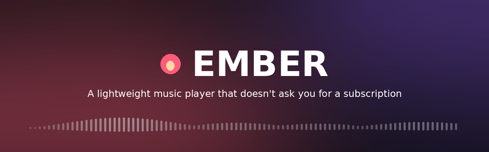

<div align="center">



Streams free, legally licensed music. Plays your own MP3s. Looks how you want
it to. Runs in about **60 MB of RAM**, because it doesn't ship a second copy of
Chrome.

[](https://github.com/1xle/ember/actions/workflows/ci.yml)
[](https://github.com/1xle/ember/releases)
[](LICENSE)
[](https://tauri.app)

**[Install on Windows](#-install-on-windows)** · [Set up Spotify](#-connect-spotify) · [Troubleshooting](#-troubleshooting) · [Build from source](#-build-from-source)

</div>

---

## Contents

1. [What you need](#-what-you-need)
2. [Install on Windows](#-install-on-windows)
3. [First run](#-first-run)
4. [Add your music](#-add-your-music)
5. [Connect Spotify](#-connect-spotify) *(optional)*
6. [Make it yours](#-make-it-yours)
7. [Keyboard shortcuts](#-keyboard-shortcuts)
8. [Troubleshooting](#-troubleshooting)
9. [Build from source](#-build-from-source)
10. [Project layout](#-project-layout)
11. [License](#-license)

---

## Features

| | |
|---|---|
| 🎧 **Free catalogue** | Hundreds of thousands of tracks from the [Audius](https://audius.co) network. No account, no API key, no ads. |
| 📁 **Your own files** | Point Ember at a music folder. It scans every subfolder, reads tags and cover art, and remembers the folder. |
| 📋 **Playlists** | Build them by hand, or import from an Audius link, a pasted song list, or Spotify. |
| 🎨 **Themeable** | Your own wallpaper, blur, darkness and accent colour. |
| ⚡ **Light on memory** | A "Reduce effects" switch turns off the glass blur for older laptops. |
| ⌨️ **Keyboard driven** | Space, arrows, `n` / `p`, `s`, `r`, `l`, `/`. |

> **What Ember does not do:** it does not download audio from Spotify or
> YouTube. Those services encrypt their streams, and tools that break that
> encryption get taken down. Ember reads your Spotify *playlists* and plays the
> matching tracks from sources that allow it.

---

## 🪟 What you need

Ember is a Windows desktop app. You need **Windows 10 (version 1809 or newer)
or Windows 11**, and about **500 MB of free disk space** for the tools.

| Tool | Why | Time |
|---|---|---|
| **Ember installer** (`.msi`) | The app itself | 1 minute |
| **Node.js** | Only if you build from source | 5 minutes |
| **Rust** | Only if you build from source | 10 minutes |
| **Visual Studio Build Tools** | Only if you build from source | 15–30 minutes |

If you just want to **use** Ember, you only need the first row.

---

## 📦 Install on Windows

### Option A — use the installer (recommended)

1. Go to the [**Releases page**](https://github.com/1xle/ember/releases/latest).
2. Under **Assets**, download **`Ember_x.y.z_x64_en-US.msi`**.
3. Double-click it.
4. Windows will say **"Windows protected your PC"**. This is normal for an app
   that isn't code-signed. Click **More info**, then **Run anyway**.
5. Click through the installer. Leave the defaults.
6. Start **Ember** from the Start menu.

<details>
<summary><b>Which file do I pick?</b></summary>

| File | Use it when |
|---|---|
| `.msi` | You want a normal install with an uninstaller in *Settings → Apps*. **Pick this.** |
| `-setup.exe` | You prefer the NSIS installer. Same result, different wizard. |

Both are built from the same code. If one fails, try the other.

</details>

### Option B — build it yourself

Skip to [Build from source](#-build-from-source).

---

## 🚀 First run

When Ember opens you'll see four things:

- **Search bar** (top) — searches the Audius catalogue.
- **Icon rail** (left) — Discover, Liked, Your files, Playlists, Import, and Look & feel at the bottom.
- **Main panel** (middle) — whatever you've picked from the rail.
- **Player bar** (bottom) — play, skip, seek, volume.

Click **Discover** and a wave of trending tracks loads. Press a row to play it.
That's the whole core loop. Everything else is optional.

> **Nothing plays?** Your connection may be down or the Audius server may be
> busy. Wait a minute and press **Try again**. Your own files still play offline.

---

## 🎵 Add your music

Ember can play music you already own, from any folder on your PC.

1. Click the **folder icon** in the rail (*Your files*).
2. Press **Choose folder**.
3. Pick the folder your music lives in, such as `C:\Users\YOU\Music`.
4. Ember scans every subfolder. You'll see a message like *"312 tracks in library"*.

Ember remembers that folder. Next time you open it, the library reloads on its
own.

**Supported formats:** MP3, M4A, AAC, OGG, OPUS, WAV, FLAC, WebM.

> **Tip:** tags and cover art are read the first time you play a track, not at
> startup. That keeps launch fast even with thousands of files.

### Make a playlist

- Press the **+** on any track to add it to a playlist. Pick one, or type a name to create it.
- Or open **Import** and paste a list (see below).

---

## 🔗 Import playlists

**YouTube playlists:** add a Google API key in **Settings → Connections**, then paste a
playlist link (one containing `list=`). Ember reads the song titles and finds
the matches on Audius. It doesn't play YouTube audio.

**Discord status:** paste a Discord application ID in **Settings → Connections**
and turn on *Discord status*. Discord must be open.

Open the **Import** tab (the chain-link icon) and paste one of these:

**An Audius link**

```
https://audius.co/artist-name/playlist-name
```

Ember reads it directly.

**A list of songs**, one per line. Write them as `Artist - Title` for the best matches:

```
Surf Curse - Freaks
Ian Asher - Take Me To The Moon
Fred again - Delilah
```

Ember searches each line and builds a playlist from what it finds. It goes five
at a time, so a 100-song list takes a minute or two. That's on purpose: firing
them all at once gets you rate-limited.

---

## 🎧 Connect Spotify

> **Easier now:** paste your Client ID in **Settings → Connections**. No rebuild needed.
> The steps below still apply for creating the Spotify app and the redirect URI.


Optional. It reads your Spotify playlists, then finds the matching tracks in
Audius and your own library.

You need a free Spotify account and about ten minutes.

### Step 1 — Create a Spotify app

1. Go to the [Spotify Developer Dashboard](https://developer.spotify.com/dashboard) and log in.
2. Click **Create app**.
3. Fill in:
   - **App name:** `Ember` (anything works)
   - **App description:** `Personal playlist import`
   - **Redirect URI:** `http://127.0.0.1:1421/callback`
   - **APIs used:** tick **Web API**
4. Tick the terms box and press **Save**.

> ⚠️ **The redirect URI must match exactly**, including `http://`, the
> `127.0.0.1` address (not `localhost`), the port `1421`, and `/callback` at the
> end. A single character out and Spotify refuses the login.

### Step 2 — Copy your Client ID

1. Open your new app in the dashboard.
2. Press **Settings**.
3. Copy the **Client ID**. It's a 32-character string of letters and numbers.

### Step 3 — Give Ember the Client ID

Ember reads the Client ID from the file it was built with, so you need to edit
that file and rebuild.

1. Open the project folder.
2. Open `src\index.html` in Notepad.
3. Press **Ctrl+F**, search for `SPOTIFY_CLIENT_ID`, and find this line:
   ```js
   var SPOTIFY_CLIENT_ID = "";
   ```
4. Paste your Client ID between the quotes:
   ```js
   var SPOTIFY_CLIENT_ID = "a1b2c3d4e5f6...";
   ```
5. Save the file.
6. Rebuild Ember (see [Build from source](#-build-from-source)), or run it in dev
   mode with `npm run dev`.

### Step 4 — Log in

1. Open **Import** and press **Connect Spotify**.
2. Your browser opens the Spotify login page. Log in and press **Agree**.
3. The browser shows *"Signed in. You can close this tab."*
4. Back in Ember, your playlists appear in a list. Press one to import it.

> **Why no password is stored anywhere:** Ember uses a standard login method
> called **PKCE**. It creates a one-time random code for each login, so there is
> no secret inside the app for anyone to steal. Spotify's login page runs in
> your real browser, so Ember never sees your password.

### Stop the connection

Go to [Spotify → Account → Apps](https://www.spotify.com/account/apps/), find
**Ember**, and press **Remove access**.

---

## 🎨 Make it yours

Open **Look & feel** (the gear icon at the bottom of the rail).

| Setting | What it does |
|---|---|
| **Wallpaper** | Pick one of six presets, or **Upload your own**. Images are resized to 1600 px so they save quickly. |
| **Wallpaper blur** | 0 to 40 px. Softens the background behind the glass panels. |
| **Darkness** | 0 to 90%. Darkens the wallpaper so text stays readable. |
| **Accent colour** | Six swatches, or the colour picker for any colour. |
| **Reduce effects** | Turns off the glass blur. Turn this on if the app stutters. |
| **Reset** | Puts everything back to the defaults. |

Your choices are saved on your PC and come back every time you open Ember.

---

## ⌨️ Keyboard shortcuts

| Key | Action |
|---|---|
| `Space` | Play / pause |
| `←` `→` | Seek 5 seconds |
| `↑` `↓` | Volume |
| `n` / `p` | Next / previous track |
| `s` | Shuffle on / off |
| `r` | Repeat: off → all → one |
| `l` | Like the current track |
| `/` | Jump to search |

Shortcuts are ignored while you're typing in a text box, so you can't skip a
track by accident while searching.

---

## 🛠️ Troubleshooting

<details>
<summary><b>"Windows protected your PC" when I open the installer</b></summary>

Ember isn't code-signed, so SmartScreen warns. Press **More info**, then
**Run anyway**. The source is public if you want to check it.

</details>

<details>
<summary><b>The window opens but is blank or grey</b></summary>

Ember's window is drawn by **Microsoft WebView2**. It's built into Windows 11
and up-to-date Windows 10, but older installs can miss it.

Install it from [Microsoft's WebView2 page](https://developer.microsoft.com/microsoft-edge/webview2/)
(the **Evergreen Bootstrapper**), then restart Ember.

</details>

<details>
<summary><b>Spotify says "INVALID_CLIENT: Insecure redirect URI"</b></summary>

The redirect URI in your Spotify app doesn't match what Ember sends. Check that
both say exactly:

```
http://127.0.0.1:1421/callback
```

Watch for `localhost` in place of `127.0.0.1`, a trailing slash, or `https`.

</details>

<details>
<summary><b>Connect Spotify says "port 1421 is busy"</b></summary>

Something else is already using that port, often a previous Ember window that
didn't close properly. Close every Ember window, then try again. To see what's
using the port, open **Command Prompt** and run:

```bat
netstat -ano | findstr :1421
```

</details>

<details>
<summary><b>Spotify login opens but then nothing happens</b></summary>

Ember waits about ten seconds for the redirect after you approve. If you
closed the browser tab early, press **Connect Spotify** again.

</details>

<details>
<summary><b>My music folder shows no tracks</b></summary>

- Check the files are one of the supported formats (see *Add your music*).
- Check Windows can read the folder. Try opening it in File Explorer first.
- Folders starting with a dot (`.`) are skipped on purpose.
- Files on a network drive or an unplugged USB drive can't be read. Reconnect
  the drive and press **Choose folder** again.

</details>

<details>
<summary><b>The app stutters or the fans spin up</b></summary>

Settings → **Reduce effects**. The glass blur is redrawn by the graphics card on
every frame, and it's the most expensive thing in the app.

</details>

<details>
<summary><b>Windows Defender or antivirus quarantines Ember</b></summary>

Unsigned apps that download and play audio sometimes trip heuristic scanners.
If your antivirus flags it, check the file came from the official Releases page,
and add an exception for the install folder. Building from source (below)
avoids this entirely.

</details>

---

## 🏗️ Build from source

Do this if you want to change the code, or you'd rather not trust an installer.

### Step 1 — Install the tools

**Node.js (LTS).** Download from [nodejs.org](https://nodejs.org) and run the
installer with the defaults. Check it worked, in PowerShell:

```powershell
node --version
```

**Visual Studio Build Tools.** Rust needs Microsoft's C++ linker.

1. Download [Build Tools for Visual Studio](https://visualstudio.microsoft.com/visual-cpp-build-tools/).
2. Run it. In the **Workloads** tab, tick **Desktop development with C++**.
3. On the right, make sure **Windows 11 SDK** (or Windows 10 SDK) is ticked.
4. Press **Install**. It's about 6 GB, so grab a drink.

**Rust.** Download [`rustup-init.exe`](https://rustup.rs) and run it. Press **1**
(the default) and let it finish. Close and reopen PowerShell afterwards, then:

```powershell
rustc --version
cargo --version
```

**Git** (optional, but it makes updating easy). Download from
[git-scm.com](https://git-scm.com).

### Step 2 — Get the code

Either clone it:

```powershell
git clone https://github.com/1xle/ember.git
cd ember
```

…or download the ZIP from GitHub (green **Code** button → **Download ZIP**),
unzip it, and open PowerShell inside the folder.

### Step 3 — Install and run

```powershell
npm install
npm run dev
```

The first run compiles the Rust side, which takes **5–10 minutes**. Every run
after that takes seconds. Ember opens in a window.

Edit `src\index.html`, save, and the window reloads. Edit `src-tauri\src\main.rs`
and you need to stop (`Ctrl+C`) and run `npm run dev` again.

### Step 4 — Build an installer

```powershell
npm run build
```

The finished installers appear in:

```
src-tauri\target\release\bundle\msi\        ← Ember_0.1.0_x64_en-US.msi
src-tauri\target\release\bundle\nsis\       ← Ember_0.1.0_x64-setup.exe
```

Double-click either one to install. A release build is faster to start and uses
less memory than `npm run dev`.

> **Build errors?** Almost always the Visual Studio Build Tools step. Run the
> installer again and make sure **Desktop development with C++** is ticked.

---

## 📁 Project layout

```
ember/
├── src/
│   └── index.html            the whole interface — one file, no build step
├── src-tauri/
│   ├── src/main.rs           three native commands: folder scan, login, open link
│   ├── Cargo.toml            Rust dependencies
│   ├── tauri.conf.json       window size, permissions, installer settings
│   └── capabilities/         what the window is allowed to ask for
├── docs/                     images for this README
├── .github/workflows/        automated checks and release builds
└── package.json
```

`src/index.html` has no dependencies and no build step. Open it in any browser
and it still works. It just hides the desktop-only features, because the
browser doesn't have the `window.__TAURI__` bridge.

---

## 🤝 Contributing

Issues and pull requests are welcome. See [CONTRIBUTING.md](CONTRIBUTING.md).

Good first issues: a new wallpaper preset, a new accent colour, more audio
formats, or a light theme.

---

## 🙏 Credits

- [Audius](https://audius.co): the open music network and its free API
- [Tauri](https://tauri.app): the desktop shell
- [jsmediatags](https://github.com/aadsm/jsmediatags): ID3 tag reading
- Fonts: [Syne](https://fonts.google.com/specimen/Syne) and [Figtree](https://fonts.google.com/specimen/Figtree)

## 📄 License

[MIT](LICENSE). Do what you like with the code.

**The music is not covered by that licence.** Audius tracks belong to the
artists who uploaded them. The API is free on the condition that you credit
them, and Ember does that by showing the artist on every track and in the
player. Please keep it that way.
